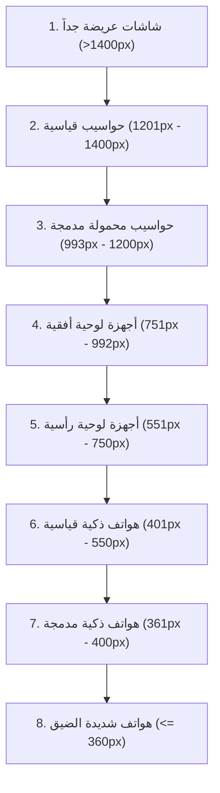

# 🌐 موقع كَنْز المَيديا — KANZ MEDIA Landing Page

موقع تعريفي وترويجي عالي الفخامة والأداء لتطبيق **كَنْز المَيديا (KANZ MEDIA)**، مبني بهندسة ويب حديثة خالية تماماً من المكتبات الخارجية الثقيلة (**Zero-Dependency Vanilla Web Stack**) مع اعتماد تصميم زجاجي مستقبلي فائق الأناقة (**Gorilla Glass & Frosted Glass Design System**)، وتجربة تفاعلية حية تحاكي شاشات وميزات التطبيق الأصلي بدقة متناهية.

---

## 📑 فهرس المحتويات

1. [نظرة عامة والتقنيات المستخدمة](#-نظرة-عامة-والتقنيات-المستخدمة)
2. [الهيكل البرمجي للمجلدات والملفات](#-الهيكل-البرمجي-للمجلدات-والملفات)
3. [نظام التصميم ولغة الزجاج الفاخر (Gorilla Glass UI)](#-نظام-التصميم-ولغة-الزجاج-الفاخر-gorilla-glass-ui)
4. [الأقسام والمكونات التفاعلية للموقع](#-الأقسام-والمكونات-التفاعلية-للموقع)
5. [المحاكاة والتجارب الحية (Live Simulators)](#-المحاكاة-والتجارب-الحية-live-simulators)
6. [منظومة التجاوب وشبكة القياسات (8 Responsive Breakpoints)](#-منظومة-التجاوب-وشبكة-القياسات-8-responsive-breakpoints)
7. [معمارية الجافاسكريبت التفاعلية (`main.js`)](#-معمارية-الجافاسكريبت-التفاعلية-mainjs)
8. [ملف التحديثات والتوزيع السحابي (`version.json`)](#-ملف-التحديثات-والتوزيع-السحابي-versionjson)
9. [إرشادات التطوير والصيانة المستقبلية](#-إرشادات-التطوير-والصيانة-المستقبلية)

---

## 🚀 نظرة عامة والتقنيات المستخدمة

تم تصميم الموقع ليكون الواجهة الرسمية لعرض وتوزيع تطبيق أندرويد الخاص بـ **كنز الميديا**، حيث يجمع بين التسويق الذكي عالي التحويل وبين توفير تجارب تفاعلية مباشرة للمستخدم قبل تنزيل ملف الـ APK.

### حزمة التقنيات (Tech Stack):
- **الهيكل والبنية الأساسية:** `HTML5` دلالي (Semantic HTML) بنظام الاتجاه الأصلي من اليمين إلى اليسار (`dir="rtl"`).
- **التصميم والتنسيق:** `CSS3 Pure` مع متغيرات التصميم (`CSS Custom Properties`) وتأثيرات الانكسار الضوئي (`Backdrop Filter`) وشبكة خطوط ضوئية وكريات هالات متوهجة ثلاثية الأبعاد متحركة (`Ambient Glow Orbs`).
- **المحرك التفاعلي:** `Vanilla JavaScript (ES6+)` خالص بدون أي مكتبات أو أطر عمل إضافية لضمان سرعة تحميل فائقة وأداء استثنائي.
- **الخطوط والطباعة:** خطوط غوغل العربية الرسمية:
  - **Cairo:** مخصص للعناوين الرئيسية وشعارات الأقسام (`font-weight: 600..900`).
  - **Tajawal:** مخصص للنصوص والفقرات وقوائم المزايا لسهولة القراءة والانسيابية.
- **الأيقونات والرسومات:** رسومات متجهة دقيقة `Inline SVG` لضمان أقصى دقة ونقاء على شاشات Retina، بالإضافة إلى `Font Awesome 6.5.1` للرموز الاجتماعية والعامة.

---

## 📁 الهيكل البرمجي للمجلدات والملفات

```text
website/
├── index.html              # الصفحة الرئيسية للموقع وتضم كافة الأقسام والنوافذ المنبثقة
├── version.json            # وثيقة التحديثات الهوائية ومطابقة الإصدار ورابط التحميل
├── README.md               # التوثيق الشامل والمتكامل للموقع (هذا الملف)
├── css/
│   └── style.css           # ملف التنسيقات الشامل (المتغيرات، التصميم، والتجاوب الكامل)
├── js/
│   └── main.js             # المحرك التفاعلي الشامل (المحاكاة، النوافذ، التبديل التلقائي)
└── assets/
    ├── og-preview.webp     # صورة المشاركة والمعاينة لشبكات التواصل (Open Graph 1200x630)
    ├── og-preview.png      # نسخة PNG الاحتياطية للمعاينة
    ├── trimmer-thumb.png   # الصورة المصغرة الأصلية المعتمدة لمحاكي اقتطاع الفيديو
    └── icons/              # أيقونات التطبيق ومنصات التواصل الرسمية بصيغة SVG/PNG
        ├── app_icon.png
        ├── tiktok-brands-solid-full.svg
        ├── instagram-brands-solid-full.svg
        ├── whatsapp-brands-solid-full.svg
        ├── telegram-brands-solid-full.svg
        ├── facebook-messenger-brands-solid-full.svg
        ├── snapchat-brands-solid-full.svg
        ├── x-solid-full.svg
        └── trash-can-solid-full.svg
```

---

## 💎 نظام التصميم ولغة الزجاج الفاخر (Gorilla Glass UI)

يعتمد الموقع على نظام لوني ليلي مستقبلي فائق الفخامة، مستوحى من واجهات زجاج الغوريلا المقوى (`Gorilla Glass`) وتطبيقات الهواتف الرائدة:

### لوحة الألوان الرئيسية (`Color Palette`):
| المتغير في CSS | القيمة | الاستخدام والدلالة |
| :--- | :--- | :--- |
| `--bg-base` | `#06080f` | الخلفية العميقة الشاملة للموقع |
| `--bg-surface` | `#151b2e` | أسطح البطاقات والحاويات الداخلية |
| `--primary` | `#8b5cf6` | البنفسجي الملكي (اللون الرئيسي لعلامة كنز ميديا) |
| `--primary-light` | `#a78bfa` | الدرجة الفاتحة للإضاءات والتوهجات والتدرجات |
| `--emerald` | `#10b981` | الأخضر الإيماني النبيل (أقسام التذكير والنجاح) |
| `--cyan` | `#0284c7` | الأزرق السماوي للميزات التقنية وتيارات البيانات |
| `--gold` | `#f59e0b` | الذهبي الدافئ لميزة الاقتطاع الحصرية والشارات |
| `--gorilla-blur` | `blur(28px) saturate(180%)` | كثافة الضبابية وتشبع الألوان للزجاج |

### الخصائص الفيزيائية للزجاج (Glassmorphism Specifications):
1. **التدرجات الشفافة المتعددة الطبقات:** خلفية بدرجات أسود كربوني مع نسب شفافية مدروسة (`rgba(28, 33, 54, 0.65)`).
2. **الحواف الضوئية المضاعفة:** حافة علوية ذات لمعان أبيض شفاف (`rgba(255, 255, 255, 0.32)`) لمحاكاة انعكاس الضوء الساقط على زجاج مقطوع بالليزر، مع حواف جانبية ناعمة.
3. **الهالات المحيطية المتحركة (`Ambient Floating Orbs`):** أربع هالات لونية ضخمة (بنفسجي، كحلي، نيلي، زمردي) تتحرك في الخلفية بحركات بطيئة سلسة تضفي حيوية وعمقاً بصرياً مريحاً للعين.

---

## 🧩 الأقسام والمكونات التفاعلية للموقع

### 1. شريط التنقل العلوي (`Site Header & Navigation`)
- **شعار العلامة التجارية:** أيقونة التطبيق بحواف دائرية ناعمة وهالة توهج خلفية مع وسم KANZ MEDIA المتوهج.
- **روابط الوصول السريع المباشر:** تنقل انسيابي فوري للأقسام الرئيسية (المنصات، المميزات، اقتطاع الفيديو، التذكير الإيماني، المعاينة الحية، الأسئلة الشائعة).
- **زر استعراض بيانات المطور:** زر مخصص لفتح نافذة حول التطبيق والمطور (`About Modal`).
- **زر التحميل المباشر:** زر زجاجي متطور لتحميل تطبيق الأندرويد مباشرة.
- **زر القائمة للأجهزة المحمولة (`Hamburger Menu`):** ثلاث خطوط ناعمة تنبثق بسلاسة في الشاشات الأصغر من `992px`.

### 2. القائمة الجانبية المنبثقة للهواتف (`Mobile Navigation Drawer`)
- درج تنقل زجاجي كامل ينزلق بنعومة من اليمين مع خلفية ضبابية معتمة (`Backdrop Blur`).
- يحتوي على ترويسة أنيقة، روابط تنقل بأيقونات ملونة ومؤشرات سهمية، وزر تحميل ثابت مخصص بحجم مريح للمس.

### 3. قسم الترحيب وهاتف التيتانيوم المتقن (`Hero Section & Phone Mockup`)
- **الجانب الأيمن (النصوص والدعوة للإجراء):**
  - كبسولة الإصدار v1.0.0 التفاعلية (قابلة للنقر لعرض مواصفات حزمة التثبيت).
  - عنوان ضخم بتدرج لوني ساحر يبرز القيمة الجوهرية للتطبيق.
  - وصف وظيفي محكم يشرح إمكانيات التطبيق.
  - أزرار الدعوة للإجراء (تحميل APK المباشر + زر الانتقال للمعاينة التفاعلية).
  - شارات الثقة (بدون إعلانات، دقة 8K، آمن 100%، إلغاء فوري بلمسة).
- **الجانب الأيسر (مجسم هاتف أندرويد الحقيقي):**
  - **شريط حالة واقعي ومطابق للأصل بنسبة 100%:**
    - الساعة الدقيقة: `1:11`.
    - سرعة الشبكة الحية: `51.0 KB/s`.
    - شريحتا اتصال مع مؤشر `VoLTE` وتقنية `5G` وأسهم نقل البيانات ومستويات التغطية الكاملة.
    - بطارية `57%` بتصميم الكبسولة الخضراء الأنيقة مع سهم الشحن المتوهج.
  - **ترويسة شاشة التطبيق الداخلية:** أيقونة القائمة الجانبية (3 أسطر متناسقة) مع اسم التطبيق.
  - **حقل الرابط التفاعلي:** أيقونة الرابط مع زر اللصق السريع الذي يضع رابط إنستغرام تجريبي عند النقر مع علامة صح خضراء.
  - **شريط الإجراءات السريعة:** حفظ الرابط + قائمة الروابط المحفوظة.
  - **زر التنزيل الرئيسي:** بلون بنفسجي بارز وأيقونة التنزيل.
  - **بطاقة التذكرة الإيمانية:** شارة نباتية خضراء مع إمكانية إغلاقها تفاعلياً.
  - **بطاقة أحدث فيديو تم تحميله:** معاينة حقيقية لآية قرآنية كريمة وحجم الملف (1.5 MB) وتاريخ التنزيل مع شبكة المشاركة المباشرة (واتساب، تيليجرام، إنستغرام، ومشاركة عامة).
  - **شريط التنقل السفلي للهاتف:** خمسة عناصر تنقل (الرئيسية، تيليجرام، واتساب، التحميلات، الإحصائيات) مع مؤشر الخط السفلي لأندرويد.

### 4. شبكة المنصات المدعومة (`Supported Platforms Grid`)
بطاقات زجاجية فاخرة تغطي كبرى منصات الوسائط العالمية:
1. **تيك توك (TikTok):** تنزيل بدون علامة مائية، دقة 1080p، وألبومات الصور.
2. **إنستغرام (Instagram):** ريلز، كاروسيل، وقصص بدون إعلانات.
3. **يوتيوب والشورتس (YouTube):** دقات تصل إلى 4K، استخراج MP3، واقتطاع مسبق.
4. **حالات واتساب (WhatsApp):** كشف وحفظ فوري في الاستوديو للرسمي والأعمال والنسخ المزدوجة.
5. **تيليجرام (Telegram):** تخطي حماية القنوات المقيدة وملفات تصل إلى 2GB.
6. **فيسبوك (Facebook):** ريلز، قصص، وفيديوهات بدقة Full HD.
7. **إكس / تويتر (X / Twitter):** استخراج التغريدات المرئية ومعارض الصور.
8. **سناب شات (Snapchat):** قصص المشاهير وسنابات Spotlight.
9. **بينتريست (Pinterest):** الفيديوهات والصور عالية الجودة.
> **ميزة تفاعلية:** النقر على أي منصة يفتح نافذة زجاجية منبثقة تفصل القدرات الهندسية الدقيقة لمحرك تلك المنصة.

### 5. شبكة الميزات الاستثنائية (`Advanced Features Spotlight`)
ست بطاقات زجاجية تستعرض الهندسة البرمجية المتفوقة:
- الإلغاء الفوري وقاتل العملية اللحظي.
- الالتقاط الذكي التلقائي من الحافظة.
- النقاء الكامل والخلو التام 100% من الإعلانات.
- قص واقتطاع المقطع قبل التنزيل لتوفير باقة الإنترنت.
- قسم المواعظ والتذكير الإيماني المتجدد.
- محرك التنزيل المتسارع المقاوم لانقطاع الاتصال.

---

## ✂️ المحاكاة والتجارب الحية (Live Simulators)

### أولاً: محاكي اقتطاع الفيديو الحقيقي (`#trimmer`)
تمت مطابقة هذا المكون هندسياً وبصرياً مع ورقة العمل السفلية (`Trimmer Bottom Sheet`) لتطبيق فلاتر الحقيقي:
- **صورة المعاينة الأصلية:** لقطة فيديو حقيقية لمحاضرة "ابدأ بلماذا؟ لسيمون سينك" مع المدة الكلية (`27:18`).
- **مفتاح التفعيل السريع (`Toggle Switch`):** يتيح تفعيل أو تعطيل الاقتطاع مع تعتيم فوري للحقول عند الإيقاف.
- **حقول الإدخال العمودية المنفصلة:**
  - **بطاقة وقت البداية (من):** محددة بإطار أخضر زمردي أنيق وأيقونة تشغيل مع حقول إدخال رقمية مخصصة للدقائق والثواني.
  - **بطاقة وقت النهاية (إلى):** محددة بإطار بنفسجي ملكي جذاب مع حقول الدقائق والثواني.
- **شرائح الاقتصاص الجاهزة (`Preset Chips`):**
  - مصفوفة منظمة تتوسط البطاقة: `[كامل المقطع]` و`[أول دقيقة]` في السطر الأول، `[أول 3 دقائق]` و`[أول 5 دقائق]` في السطر الثاني، و`[آخر دقيقة]` في السطر الثالث.
  - مزامنة فورية ثنائية الاتجاه: النقر على أي شريحة يغير الأرقام والنتيجة تلقائياً، وتعديل الأرقام يحدد الشريحة المتطابقة تلقائياً.
- **كبسولة النتيجة الحسابية:** تعرض المدة الناتجة بالثواني والدقائق بخط عريض وعلامة صح خضراء بارزة.

### ثانياً: قسم التذكير الإيماني المبارك (`#reminders`)
- **الوسام الروحاني المضيء:** أيقونة المصحف الشريف فوق الحامل الخشبي محاطاً بهلال رمضان والنجم المضيء بتدرج زمردي وذهبي.
- **محرك الأذكار والأدعية التفاعلي:** يعرض نصوصاً وأدعية نبوية وقرآنية بين قوسي تنصيص كلاسيكيين.
- **زر التبديل الذكي (`دعاء وموعظة أخرى`):** يتنقل بسلاسة عبر 5 أدعية ومواعظ مباركة بتأثير تلاشٍ وانزلاق حركي ناعم.
- **شريط الركائز الروحية:** كبسولات إيمانية (ذكر الله ومراقبته، حفظ السمع والبصر، استثمار الوقت، نشر الكلمة الطيبة).

### ثالثاً: محاكي بطاقة التحميل وتأكيد التنزيل (`#interactive-demo`)
- **تبويبات المنصات الأربعة (تيك توك، إنستغرام، يوتيوب، حالات واتساب):** تصميم أحادي أنيق وخالٍ من الظلال المزعجة أو المقصوصة.
- **مؤشر وتدوير تلقائي كل 5 ثوانٍ:** يتنقل المحاكي تلقائياً بين المنصات كل 5 ثوانٍ، ويتوقف التدوير فوراً وبذكاء عند وضع مؤشر الفأرة أو لمس الشاشة للتفاعل مع المحاكي.
- **تحديث ديناميكي للأيقونات والنصوص الإعلانية:**
  - تتغير أيقونة المنصة في الكبسولة السفلية بشكل ديناميكي لتطابق المنصة المحددة (SVG أصلي لكل منصة).
  - تتغير نصوص الوصف الإعلانية المكتوبة لتبرز ميزة التطبيق في المنصة المحددة (تيك توك بدون علامة مائية، إنستغرام ريلز، يوتيوب 4K وMP3، وحفظ حالات واتساب).
- **زرّا الإجراء المتناسقان:**
  - زر **[ ✕ إلغاء ]** على الطرف الأيمن بتصميم شفاف محدد.
  - زر **[ 📥 تحميل الآن ]** على الطرف الأيسر بتصميم بارز متدرج.
- **محاكاة عملية التحميل:** النقر على "فحص الرابط" أو "تحميل الآن" يطلق شريط تقدم تحميل متسارع حقيقي بنسبة مئوية تنتهي بالإشعار بنجاح الحفظ في المعرض.

### رابعاً: منظومة الأسئلة الشائعة العصرية الفاخرة (`#faq`)
- **تصميم زجاجي تفاعلي حديث:** تحويل الأكورديون التقليدي إلى بطاقات غوريلا جلاس متطورة بحواف مضيئة تتفاعل بمرونة عند الفتح والتحويم.
- **أوسمة موضوعية لكل سؤال:** وسام زجاجي أيقوني مستقل لكل بطاقة يعبّر عن موضوع السؤال (درع الأمان، أيقونة يوتيوب، مقص الاقتطاع، شرارة تيك توك، واتساب، تيليجرام، بطارية الخلفية، مجلد التخزين).
- **زر سهمي دائري متحرك:** زر سهم زجاجي SVG ينعطف بزاوية 180 درجة بسلاسة ونعومة فيزيائية مع توهج بنفسجي عند فتح السؤال.
- **أسئلة واقعية جوهرية:** 8 أسئلة مدروسة تجيب على تساؤلات المستخدمين الحقيقية بدقة (الأمان والخلو من الإعلانات، تقنية 4K ودمج الصوت، الاقتطاع بدون إعادة ترميز، ألبومات تيك توك والريلز، سرية حفظ حالات واتساب، تخطي حظر قنوات تيليجرام، استمرار التنزيل عند قفل الشاشة في شاومي وسامسونج، ومسار حفظ الملفات في المعرض).
- **كبسولات توضيحية ذكية:** كل إجابة تختتم بكبسولة وسم زجاجية بنقطة زمردية تشع بنقاط القوة التقنية للحل.

### خامساً: بطاقة الدعوة للتحميل الفاخرة (`.final-cta-section`)
- **محراب زجاجي أسطوري ثلاثي الأبعاد:** منصة احتضان مضيئة لأيقونة التطبيق محاطة بهالة نورانية عميقة وتدرجات بنفسجية وسماوية مع إطار زجاجي عاكس للضوء.
- **تاج وشارة الإصدار الرسمي المستقر:** كبسولة علوية براقة برمز التاج الملكي توضح جاهزية الإصدار المستقر v1.0.0.
- **زر التحميل الرائد الفاخر (`.btn-flagship-cta`):** تصميم رائد بتدرج لوني ملكي متوهج، إطار ضوئي عاكس، حركة مسح شعاع ضوئي سينمائي (`Shimmer Sheen Sweep`) وأيقونة تنزيل بحركة نبض متجاوبة.
- **شريط أوسمة الثقة والمواصفات الزجاجية:** 4 كبسولات زجاجية متراصة بأيقونات مميزة (توافق أندرويد 7.0+، التحديث الهوائي السحابي، فحص السلامة 100%، والخلو الصارم من الإعلانات).

### سادساً: التذييل الفاخر الشامل والقضاء على فراغ النهاية (`.site-footer`)
- **هيكل زجاجي ملكي بأربعة أعمدة متوازنة:**
  - **عمود الهوية:** أيقونة التطبيق في وسام زجاجي، حالة النظام النابضة (`v1.0.0 Stable`)، وصف المنظومة، وأزرار شبكات التواصل والتفاعل السريع.
  - **عمودا الروابط المصنفة:** تقسيم الروابط إلى مجموعتين أنيقتين (أقسام المنظومة، والدعم والمواصفات)، تتحولان في الهواتف إلى شبكة متناسقة بعمودين متجاورين (`2-Column Grid`) تملأ العرض بانسجام تام بدلاً من التكدس الرأسي الطويل.
  - **بطاقة التحميل المباشر التفاعلية:** صندوق زجاجي متقدم يتيح **نسخ رابط التحميل بنقرة واحدة** مع مؤشر تأكيد لحظي (`✓ تم النسخ`) وزر فتح مباشر، مع شريط التحقق من السيرفرات والأمان.
- **الشريط السفلي للحقوق:** ضبط نصوص الاتجاهين (`BiDi / LTR`) بدقة، وإبراز اسم المطور **SULAIMAN SHO** برابط تفاعلي، مع دعاء إيماني مبارك.
- **معالجة فراغ النهاية (`Zero Bottom Gap`):** إلغاء التباعد المزدوج على الهواتف بدمج إزاحة الشريط السفلي العائم (`Mobile Sticky Bar`) داخل الفوتر مباشرة، مما يضمن تدفق الخلفية الزجاجية الداكنة حتى أسفل الشاشة واختفاء الفراغ الأسود تماماً.

---

## 📱 منظومة التجاوب وشبكة القياسات (8 Responsive Breakpoints)

تمت هندسة التجاوب ليعمل بأعلى درجات الاتزان على كافة الشاشات بدون أي تشوه أو خروج للعناصر خارج الشاشة، مع مراعاة متناهية للشاشات الصغيرة:



### تفاصيل المعالجة الخاصة للشاشات الصغيرة والهواتف:
1. **الشاشات ما بين 361px و 400px (مثل 370px، 384px، 390px، 400px):**
   - ضبط حجم الخط الجذري `html { font-size: 14px; }`.
   - تثبيت الهوامش الجانبية الصارمة (`Container Padding: 20px`) لمنع التصاق الأقسام والبطاقات بأطراف الشاشة.
   - موازنة دقيقة لجميع الخطوط: فرق الحجم لا يتجاوز بكسل واحد (~1px) مقارنة بالشاشات الأصغر (`hero-title: 1.44rem / 20.1px`, `section-title: 1.35rem / 18.9px`).
   - تحويل حقول الاقتطاع إلى بطاقات عمودية متتالية بعرض متكامل ومقاييس رقمية هادئة للأصابع.
2. **الشاشات شديدة الصغر (أقل من أو يساوي 360px):**
   - ضبط حجم الخط الجذري `html { font-size: 13.5px; }`.
   - هوامش الحاوية: `18px` متوازنة وثابتة بدون أي التواء.
   - تناسق العناوين المدمجة: (`hero-title: 1.42rem / 19.1px`, `section-title: 1.32rem / 17.8px`).
   - تصغير هاتف التيتانيوم إلى عرض أقصى `260px` مع إخفاء الشارات العائمة الخارجية لمنع شريط التمرير الأفقي العرضي.
   - تصغير شريط الحالة بمعدل `scale(0.92)` للمحافظة على محاذاة كافة الأيقونات (الـ VoLTE والبطارية والساعة) في سطر واحد بدون انكسار.
   - نافذة الحوار الزجاجية (`Modal`) تتحول إلى صندوق حوار وسطي متكامل بعرض `100%` بحد أقصى `340px` مع أزرار بنسبة `50% / 50%` في صف أفقي واحد.

---

## ⚙️ معمارية الجافاسكريبت التفاعلية (`main.js`)

ملف `main.js` منظم بنظام الوحدات المترابطة المستقلة:

| الوحدة / المعالج | الوظيفة | العناصر المرتبطة |
| :--- | :--- | :--- |
| **Mobile Drawer Controller** | فتح وإغلاق القائمة الجانبية مع قفل التمرير والخلفية الضبابية | `#mobileMenuBtn`, `#mobileDrawer`, `#drawerBackdrop` |
| **Mockup Controls** | محاكاة زر اللصق، إغلاق تذكرة الهيرو، والتغذية البصرية | `#mockupPasteDemoBtn`, `#mockupReminderCloseBtn` |
| **Trimmer Engine** | حساب الفوارق الزمنية وتحديث الحقول ومزامنة الشرائح الجاهزة | `#startMin`, `#startSec`, `#endMin`, `#endSec`, `.preset-chip` |
| **Islamic Cycler** | تدوير الأدعية الخمسة بحركة انتقال وتلاشٍ ناعمة | `#btnNextReminder`, `#reminderQuote` |
| **Simulator Auto-Rotate** | تدوير المنصات كل 5 ثوانٍ مع التعليق التلقائي عند التفاعل | `setInterval`, `setSimPlatform()`, `.interactive-simulator-card` |
| **Download Simulation** | محاكاة الفحص وتدفق سرعة التنزيل حتى 100% | `#simActionBtn`, `#simDownloadNowBtn`, `#simProgressBlock` |
| **FAQ Accordion** | فتح وإغلاق بنود الأسئلة الشائعة مع معايير الوصول (ARIA) | `.accordion-header`, `.accordion-item` |
| **Universal Glass Modal** | إدارة النوافذ المنبثقة لبيانات المطور، التحميل، ومواصفات المنصات | `openGlassModal()`, `closeGlassModal()`, `#glassModalOverlay` |

---

## 📡 ملف التحديثات والتوزيع السحابي (`version.json`)

يقوم تطبيق أندرويد بفحص هذا الملف دورياً للتحقق من وجود تحديثات جديدة عبر السحابة:

```json
{
  "id": "app_version",
  "latest_version": "1.0.0",
  "min_supported_version": "1.0.0",
  "is_force_update": false,
  "release_notes": "الإصدار الرسمي لتطبيق كنز الميديا مع محرك التحميل عالي السرعة، ميزة اقتطاع المقاطع قبل التنزيل، حفظ حالات واتساب، والتذكير الإيماني المبارك.",
  "android_download_url": "https://kanz.sulaimansho.com/kanz_media.apk",
  "updated_at": "2026-10-23T06:00:00Z"
}
```

### البنية السحابية للتوزيع:
- **نطاق التنزيل المباشر:** `https://kanz.sulaimansho.com/kanz_media.apk`
- **التخزين السحابي:** مستضاف عبر شبكة **Cloudflare R2** بنظام انعدام رسوم الخروج (Zero Egress Fees) لضمان أقصى سرعة تنزيل للمستخدمين في كافة أنحاء العالم دون أي حدود على عرض النطاق الترددي.

---

## 🛠️ إرشادات التطوير والصيانة المستقبلية

عند إجراء أي تحديثات أو تعديلات على الموقع في المستقبل، يُرجى الالتزام الصارم بالقواعد التالية:

1. **سلامة توازن الأقواس في CSS:**
   - يجب دائماً التحقق من توازن الأقواس المعقوفة `{}` في ملف `css/style.css`.
   - عند تعديل استعلامات الوسائط (`@media`)، تأكد من عدم تصفير هوامش الحاويات الجانبية على الشاشات التي تقل عن `400px`.
2. **ثبات شريط حالة الهاتف (`Phone Status Bar`):**
   - عناصر شريط الحالة (`1:11`, `VoLTE`, `5G`, `57%`) تم ضبطها بمقاييس دقيقة؛ تجنب استبدالها بصور ثابتة أو تفكيكها لضمان مطابقتها الدقيقة للواقع.
3. **أزرار النوافذ المنبثقة:**
   - الحفاظ على الترتيب الطبيعي للواجهات العربية RTL: زر الإلغاء/الإغلاق يكون على الطرف الأيمن، وزر الإجراء الإيجابي (التحميل/التأكيد) يكون على الطرف الأيسر.
4. **تجنب المكتبات الثقيلة:**
   - الحفاظ على الموقع بصيغة جافاسكريبت وCSS خالصة، دون جلب مكتبات مثل Bootstrap أو jQuery أو Tailwind لضمان بقاء سرعة الاستجابة اللحظية `100/100` في اختبارات Google PageSpeed.

---

<div align="center">
  <p><strong>كَنْز المَيديا — KANZ MEDIA</strong></p>
  <p>صُمم وهُندس بكل إتقان واحترافية بواسطة <strong>SULAIMAN SHO</strong> © 2026</p>
</div>
